# Guía de uso · Sistema de Posgrado UTN FRLP

> **Versión v0.5 (Core).** Las capturas son de esta versión.

Para levantarlo: `docker compose up --build` y entrar a http://localhost:3000. Los emails de prueba llegan a MailHog: http://localhost:8025.

## Aspirante

El aspirante no tiene usuario ni contraseña: entra con el link que le llega por email.

### 1. Inscribirse

En http://localhost:3000/inscripcion completás tus datos, elegís una o dos carreras y, si querés, pedís beca; al tocar "Guardar y continuar con la documentación" se crea tu preinscripción.

### 2. Recibir el link

Te llega un email con tu código de seguimiento y el botón "Continuar mi preinscripción", que vence a los 60 días.

### 3. Ver tu preinscripción

Con el link entrás a "Mi preinscripción", donde ves el estado, qué documentos te faltan y tus datos.

### 4. Subir los PDFs

En cada documento tocás "Seleccionar archivo PDF": solo se aceptan PDF de hasta 5 MB, y si subís otro del mismo tipo reemplaza al anterior.

### 5. Enviar a revisión

Cuando tenés todos los documentos obligatorios, "Enviar a revisión" se habilita y te pide confirmar antes de mandar.

Al confirmar, la página pasa a Pendiente, te avisa "Recibimos tu preinscripción" y te llega un email con tu código de seguimiento.

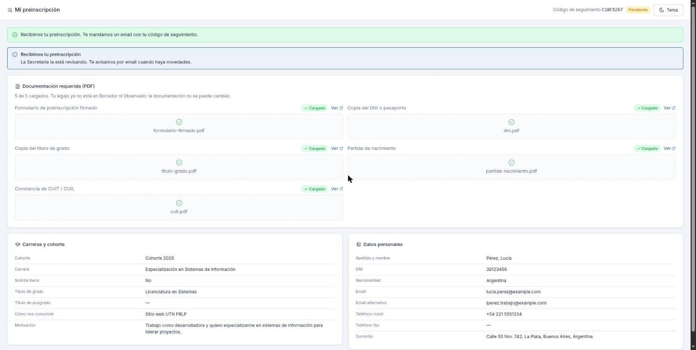

### 6. Recuperar el link

Si perdiste el email, en la parte de arriba del formulario escribís tu email y tocás "Enviarme el link".

### 7. Ver una observación y corregir

Si la Secretaría te pide algo, lo ves arriba de todo en amarillo; corregís, tocás "Reenviar corrección" y confirmás.

Si lo que hay que corregir es un dato, tocás "Editar mis datos", lo cambiás y guardás; si es un documento, subís el PDF nuevo en su lugar.

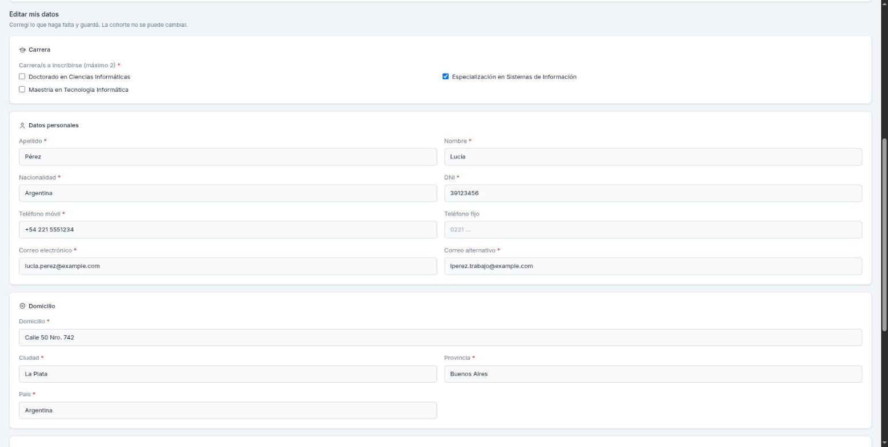

Cuando terminaste, tocás "Reenviar corrección" y confirmás: vuelve a Pendiente y te llega el email "Recibimos tu corrección".

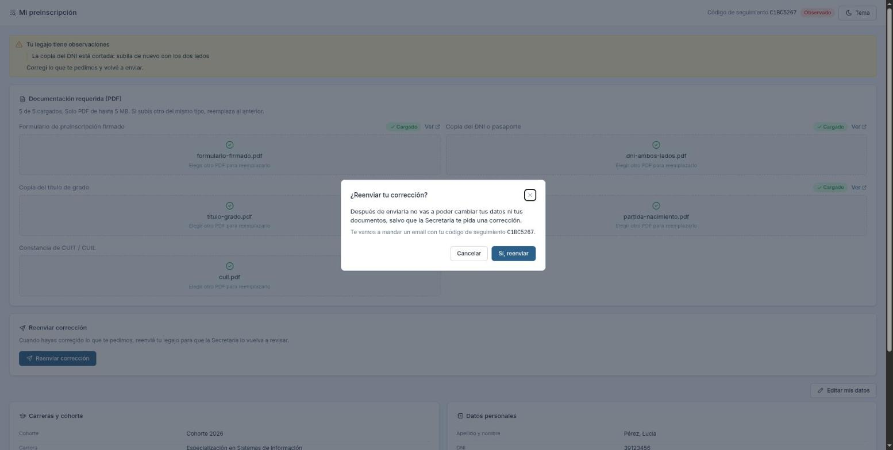

### 8. Ver la aprobación

Cuando te aprueban, ves tu número de legajo y la fecha límite para matricularte.

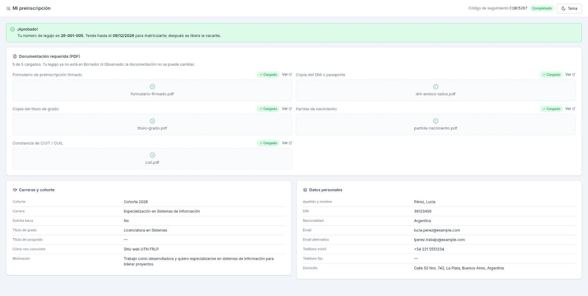

## Coordinador

### 1. Entrar

En http://localhost:3000/login entrás con tu email y contraseña (en desarrollo: `admin@fenix.test` / `Admin1234!`).

### 2. Ver el dashboard

Arriba ves los totales de la cohorte y, abajo, todos los inscriptos con su estado y cuántos documentos subieron.

### 3. Buscar y filtrar

Buscás por DNI (con o sin puntos) o por apellido (3 letras como mínimo) y combinás los filtros de estado, carrera y beca.

### 4. Abrir y cerrar el período

Con el interruptor "Período de inscripción" de arriba a la derecha abrís o cerrás la inscripción de la cohorte; al cerrarla podés poner la fecha de la próxima apertura, que el formulario le muestra al aspirante.

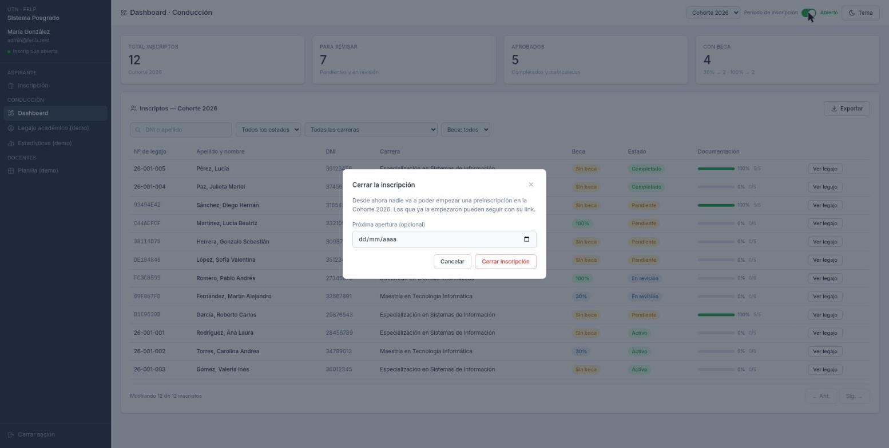

### 5. Abrir un legajo

En el dashboard tocás "Ver legajo" y ves los datos, las carreras y la beca, los documentos, el historial y las acciones que se pueden hacer en ese estado.

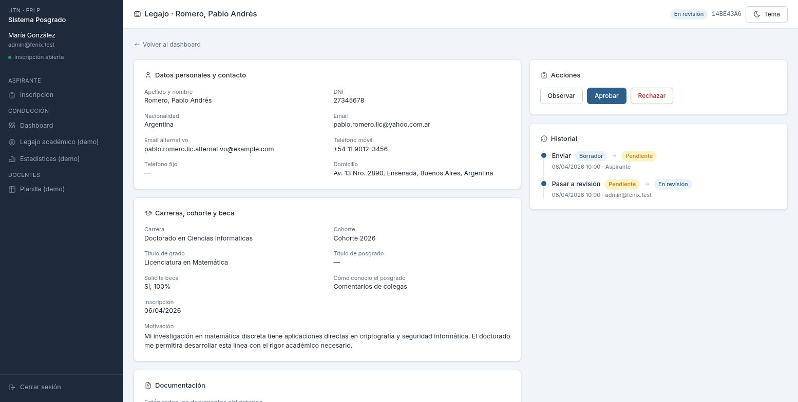

### 6. Ver un PDF

En "Documentación" tocás "Ver" al lado del documento y el PDF se abre en una ventana, sin salir del legajo.

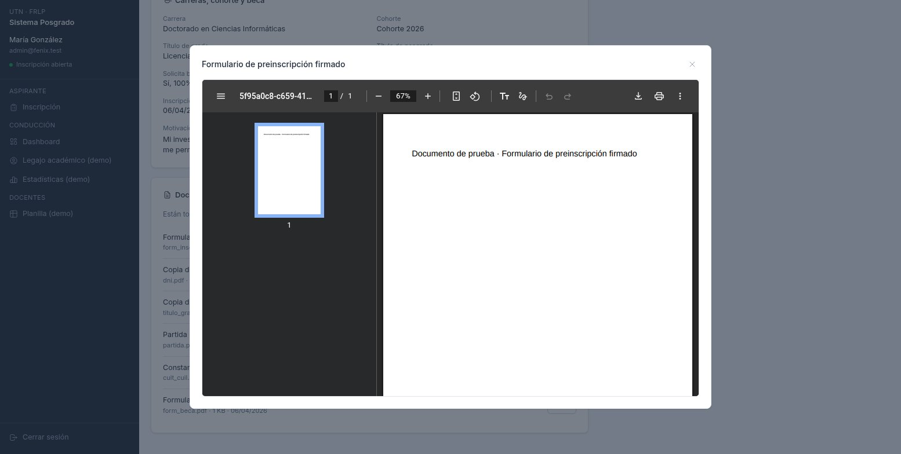

### 7. Pasar a revisión

En un legajo Pendiente tocás "Pasar a revisión": queda En revisión y el cambio se anota en el historial.

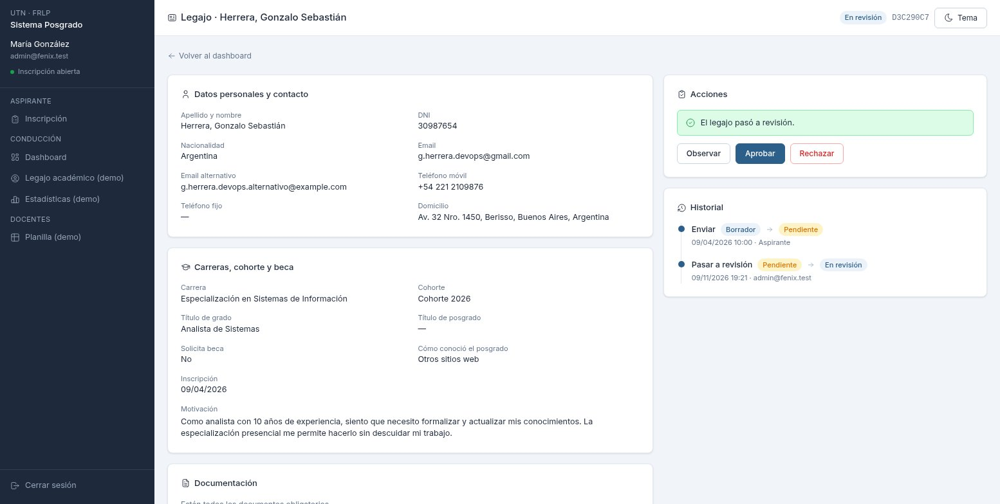

### 8. Observar

Si falta algo, tocás "Observar" y escribís qué tiene que corregir: al aspirante le llega por email y el legajo queda Observado ("Rechazar" funciona igual, con un comentario opcional).

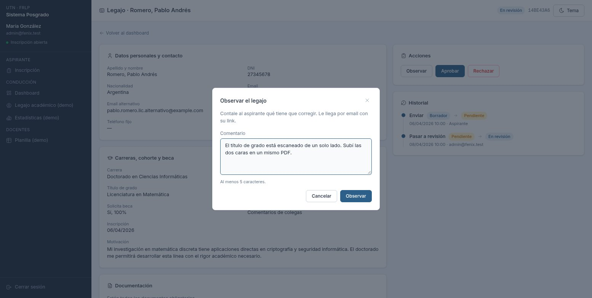

### 9. Aprobar

Tocás "Aprobar" y confirmás: se asigna el número de legajo y el aspirante recibe un email con 30 días para matricularse.

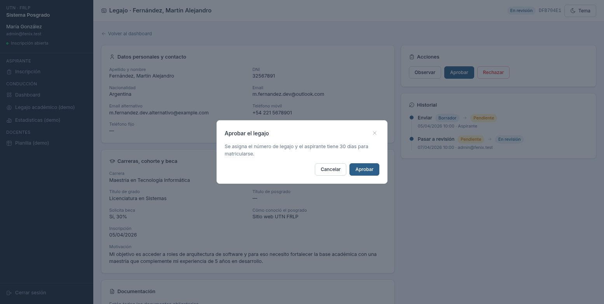

Al confirmar, el número de legajo aparece arriba y en el aviso, y el legajo queda Completado.

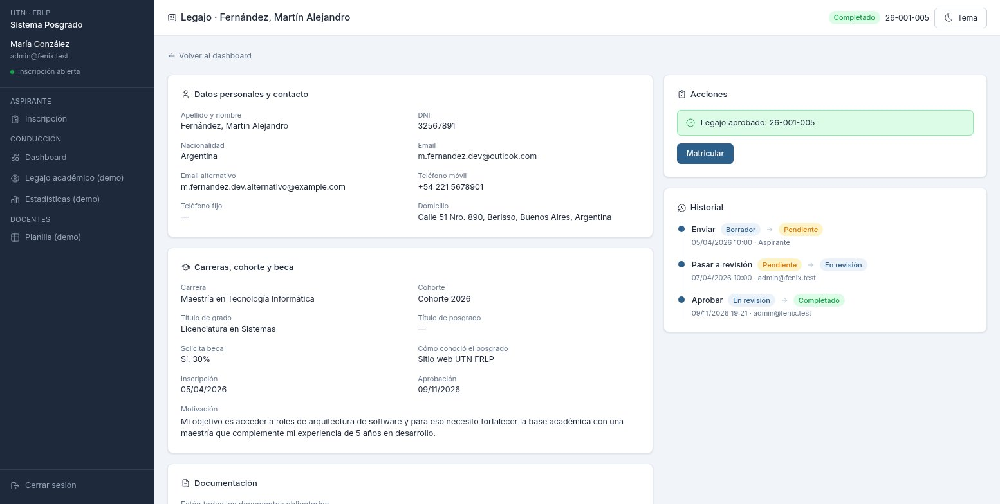

### 10. Matricular

Cuando el aspirante se matricula, en el legajo Completado tocás "Matricular" y confirmás: pasa a Activo.

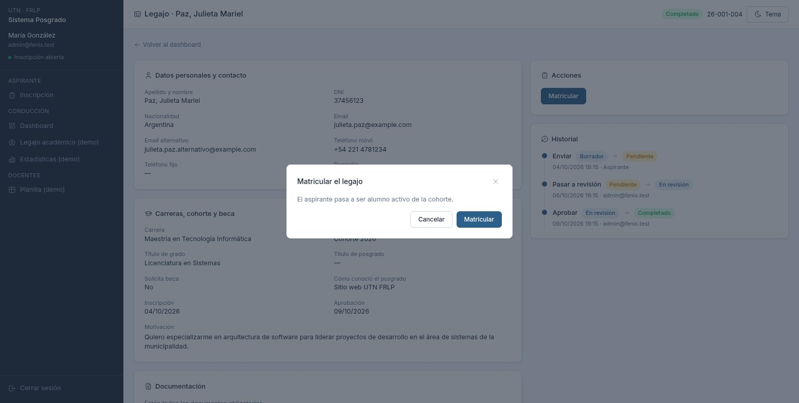

### 11. Exportar a Excel

Con la búsqueda y los filtros que quieras, tocás "Exportar" y se baja `inscriptos-cohorte2026-AAAA-MM-DD.xlsx` con los mismos legajos de la tabla.

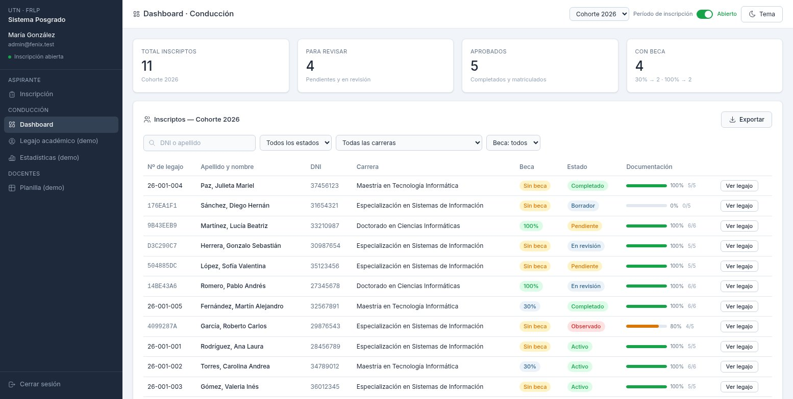
