# Guía de uso · Sistema de Posgrado UTN FRLP

> **Borrador (6/11).** Están los pasos que ya funcionan en `develop`. Los marcados con 🚧 se completan cuando entren F6 (enviar y editar), D5 (detalle del legajo) y L5 (Excel).

Para levantarlo: `docker compose up --build` y entrar a http://localhost:3000. Los emails de prueba llegan a MailHog: http://localhost:8025.

## Aspirante

El aspirante no tiene usuario ni contraseña: entra con el link que le llega por email.

### 1. Inscribirse

En http://localhost:3000/inscripcion completás tus datos, elegís una o dos carreras y, si querés, pedís beca; al tocar "Guardar y continuar con la documentación" se crea tu preinscripción.

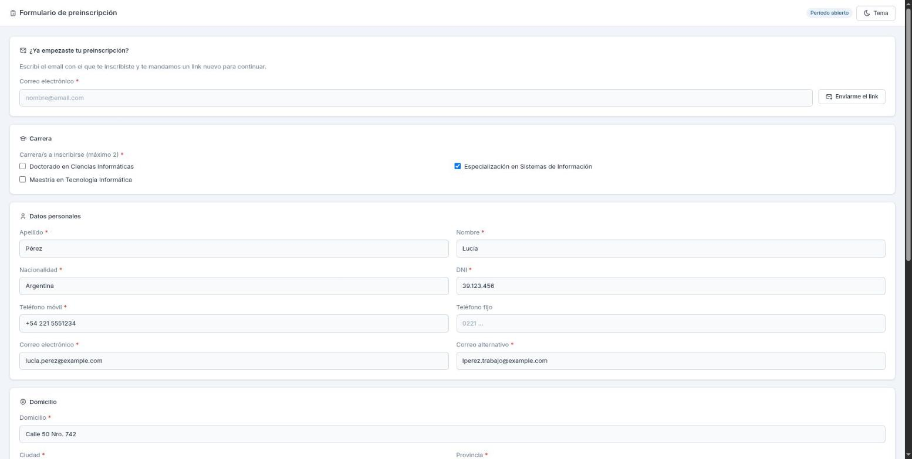

### 2. Recibir el link

Te llega un email con tu código de seguimiento y el botón "Continuar mi preinscripción", que vence a los 60 días.

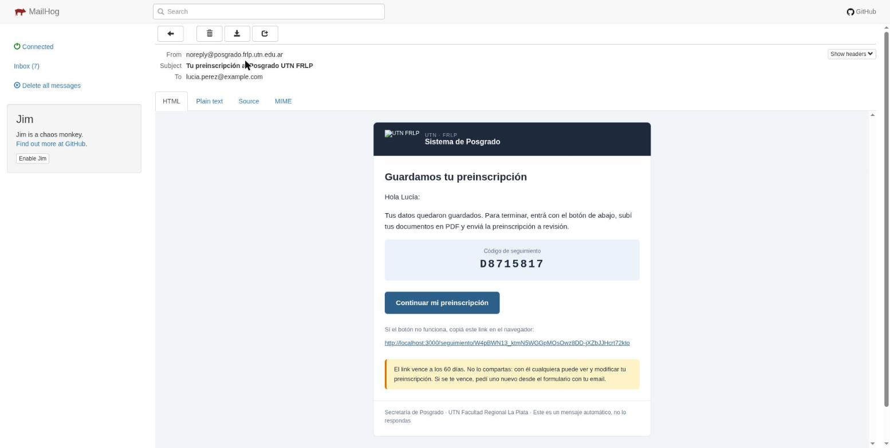

### 3. Ver tu preinscripción

Con el link entrás a "Mi preinscripción", donde ves el estado, qué documentos te faltan y tus datos.

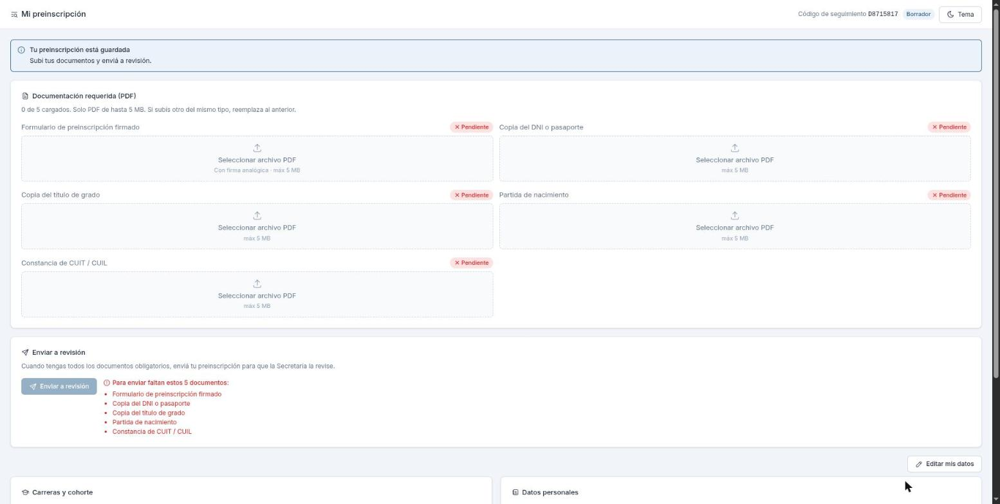

### 4. Subir los PDFs

En cada documento tocás "Seleccionar archivo PDF": solo se aceptan PDF de hasta 5 MB, y si subís otro del mismo tipo reemplaza al anterior.

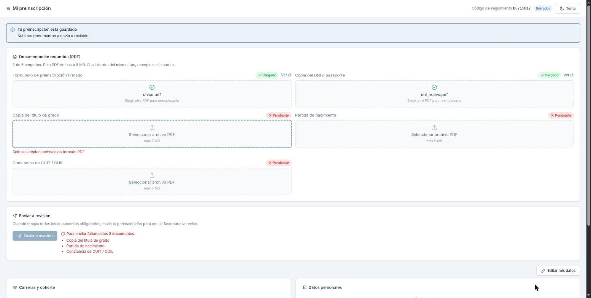

### 5. Enviar a revisión 🚧

Cuando tenés todos los documentos obligatorios, "Enviar a revisión" se habilita y te pide confirmar antes de mandar.

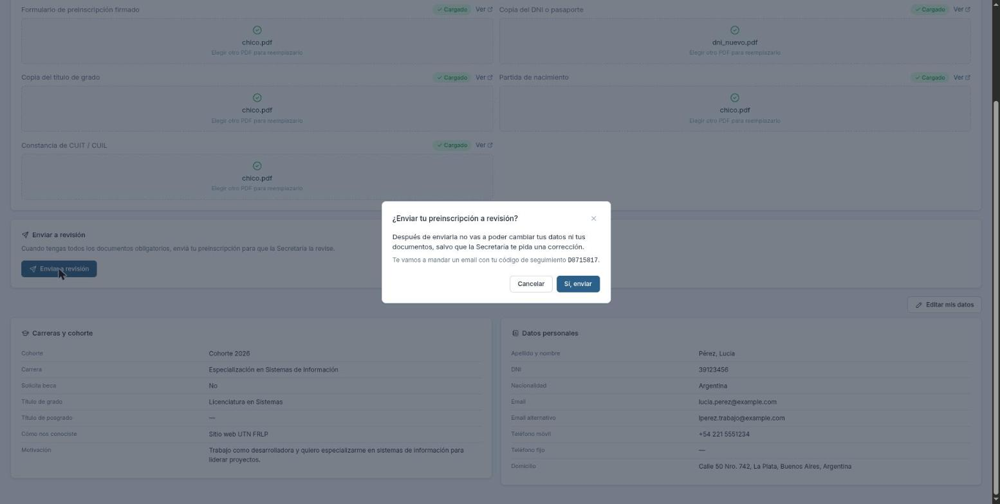

> 🚧 Falta la captura del mensaje "Recibimos tu preinscripción" (necesita F6).

### 6. Recuperar el link

Si perdiste el email, en la parte de arriba del formulario escribís tu email y tocás "Enviarme el link".

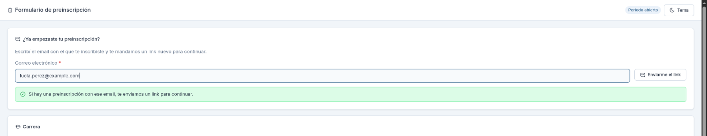

### 7. Ver una observación y corregir 🚧

Si la Secretaría te pide algo, lo ves arriba de todo en amarillo; corregís, tocás "Reenviar corrección" y confirmás.

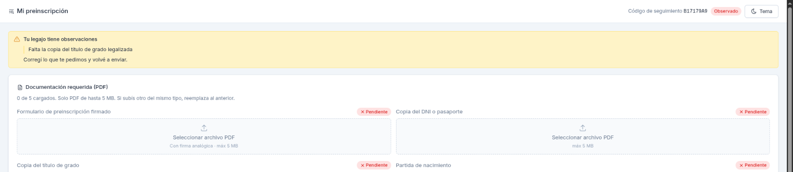

> 🚧 Falta la captura de "Editar mis datos" guardando y del reenvío (necesita F6).

### 8. Ver la aprobación

Cuando te aprueban, ves tu número de legajo y la fecha límite para matricularte.

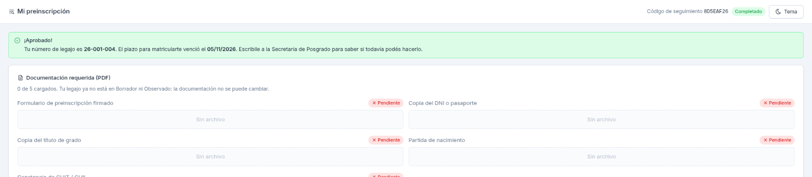

> 🚧 Reemplazar por un legajo aprobado dentro del plazo (el del seed ya venció) cuando se pueda recorrer el flujo completo.

## Coordinador

### 1. Entrar

En http://localhost:3000/login entrás con tu email y contraseña (en desarrollo: `admin@fenix.test` / `Admin1234!`).

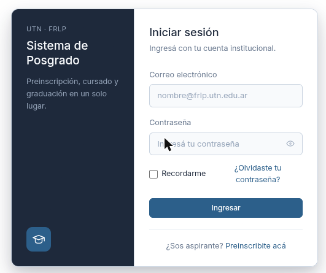

### 2. Ver el dashboard

Arriba ves los totales de la cohorte y, abajo, todos los inscriptos con su estado y cuántos documentos subieron.

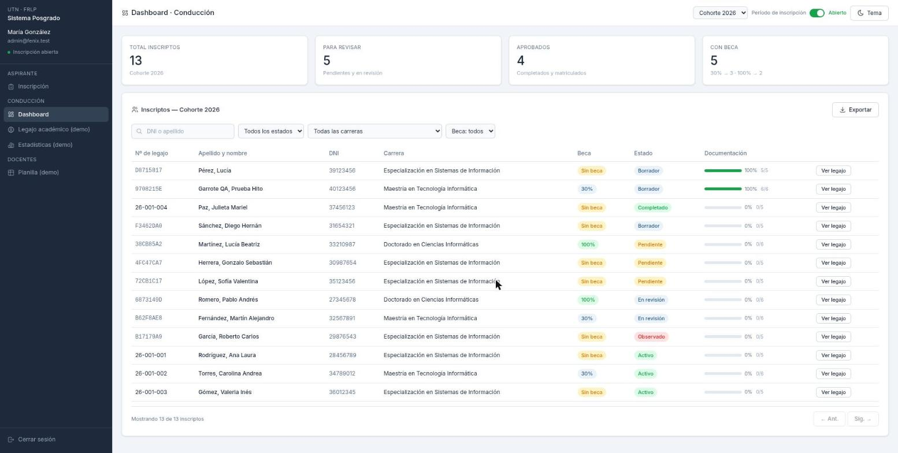

### 3. Buscar y filtrar

Buscás por DNI (con o sin puntos) o por apellido (3 letras como mínimo) y combinás los filtros de estado, carrera y beca.

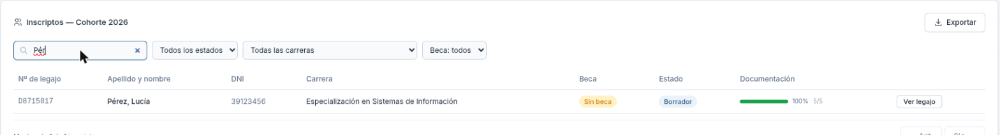

### Pendientes 🚧

- Abrir un legajo y ver un PDF (D5).
- Revisar, observar, aprobar y matricular (D5).
- Abrir y cerrar el período de inscripción (el interruptor de arriba a la derecha del dashboard).
- Exportar a Excel (L5).
